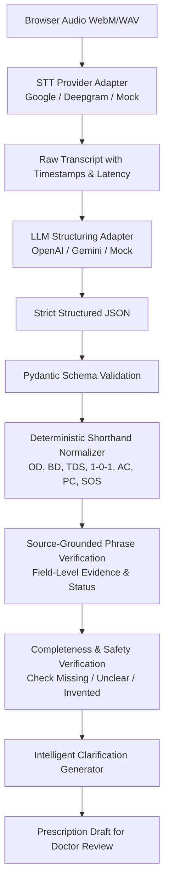

# AI Pipeline Specification

## 1. Pipeline Overview

The Voice Prescription Writer converts unstructured audio of a clinical dictation into a fully validated, source-grounded, structured prescription through an explicit multi-stage pipeline:



## 2. Audio Capture & STT Adapter Layer

### Input Formats
- WebM (`audio/webm;codecs=opus`) as primary browser format
- WAV / MP4 / OGG as fallbacks
- 16 kHz or 48 kHz sampling rate, 16-bit mono

### Adapter Interface (`STTProvider`)
```python
class STTProvider(ABC):
    @abstractmethod
    async def transcribe(self, audio_path: str, audio_format: str = "webm") -> STTResult:
        """Returns STTResult(text, provider, model, latency_ms, word_timestamps, confidence, language)"""
        ...
```

### Safety & Grounding Principles in STT:
1. **Preserve Audio**: Audio is written to immutable storage at `uploads/audio/{prescription_id}_{timestamp}.webm`.
2. **Preserve Metadata**: Provider name, model version, execution latency, word-level timestamps (when genuinely returned), and genuine confidence scores are stored.
3. **No Fabricated Confidence**: If a provider does not return word or segment confidences, `confidence` is stored as `None`.
4. **Resilience**: Timeout after 30 seconds; on timeout or network error, a clear error code is returned without crashing the pipeline.

## 3. LLM Extraction & System Prompt

### Strict Non-Inference Rules:
1. **Never Infer Diagnosis from Symptoms**: If the doctor only says "Patient has fever and cough", `diagnosis` must have status `"not_mentioned"` or `"unclear"`. Diagnosis is ONLY populated if explicitly dictated (e.g., "Diagnosis: acute bronchitis").
2. **Never Infer Strengths or Doses**: If the doctor says "give Azithromycin", do NOT guess "500mg". `strength` must be marked `"not_mentioned"` and flagged for doctor review.
3. **Never Infer Durations**: If the doctor says "take Amlodipine once daily" without mentioning days or weeks, leave duration `"not_mentioned"`. Do NOT guess "for 30 days".
4. **Never Infer Route**: Only extract routes explicitly stated (oral, IV, IM, topical, inhalation).
5. **Self-Corrections**: When a doctor corrects themselves (e.g., "Give Sumatriptan 50mg... actually make that 25mg"), the final dictated intent must be selected.
6. **Medicine Removals**: When a doctor retracts a drug (e.g., "Remove the Amitriptyline, she is already on it"), that drug must be excluded from the final medicine list.

### Structured Extraction Schema
The LLM returns strict JSON matching:
```json
{
  "patient": {
    "name": {"value": "Ramesh Kumar", "source_text": "Patient Ramesh Kumar", "status": "extracted"},
    "age": {"value": 45, "source_text": "45 years old", "status": "extracted"},
    "sex": {"value": "male", "source_text": "male", "status": "extracted"}
  },
  "clinical": {
    "chief_complaints": {"value": "fever and body ache since 3 days", "source_text": "fever and body ache since 3 days", "status": "extracted"},
    "diagnosis": {"value": null, "source_text": null, "status": "not_mentioned"},
    "investigations": {"value": null, "source_text": null, "status": "not_mentioned"},
    "advice": {"value": null, "source_text": null, "status": "not_mentioned"},
    "follow_up": {"value": null, "source_text": null, "status": "not_mentioned"}
  },
  "medicines": [
    {
      "name": {"value": "Dolo", "source_text": "tablet Dolo", "status": "extracted"},
      "strength": {"value": "650mg", "source_text": "650", "status": "extracted"},
      "form": {"value": "tablet", "source_text": "tablet", "status": "extracted"},
      "dose": {"value": "1 tablet", "source_text": "one tablet", "status": "extracted"},
      "frequency": {"value": "TDS", "source_text": "three times a day", "status": "extracted"},
      "timing": {"value": "after food", "source_text": "after food", "status": "extracted"},
      "duration": {"value": "5 days", "source_text": "for 5 days", "status": "extracted"},
      "route": {"value": "oral", "source_text": "oral", "status": "extracted"}
    }
  ]
}
```

## 4. Shorthand Normalization Layer

Runs as deterministic Python post-processing (not entrusted solely to LLM):
- Frequency mapping:
  - `OD` -> "Once Daily (OD)" (1 time/day)
  - `BD` / `BID` -> "Twice Daily (BD)" (2 times/day)
  - `TDS` / `TID` -> "Three Times Daily (TDS)" (3 times/day)
  - `QID` -> "Four Times Daily (QID)" (4 times/day)
  - `HS` -> "At Bedtime (HS)" (1 time/day at night)
  - `SOS` / `PRN` -> "As Needed (SOS)" (conditional)
  - `STAT` -> "Immediately (STAT)" (single dose)
  - `1-0-1` -> "Morning and Night (1-0-1)" (2 times/day)
  - `1-1-1` -> "Morning, Afternoon, Night (1-1-1)" (3 times/day)
  - `1-0-0` -> "Morning Only (1-0-0)" (1 time/day)
  - `0-0-1` -> "Night Only (0-0-1)" (1 time/day)
- Timing mapping:
  - `AC` / "before breakfast" / "empty stomach" -> "Before Meals (AC)"
  - `PC` / "after food" / "after meals" -> "After Meals (PC)"

Both the raw spoken phrase (`source_text`) and the normalized code (`frequency_normalized`) are preserved.

## 5. Source-Grounded Verification Layer

1. **Exact/Fuzzy Substring Search**:
   For every field with `status="extracted"` and a `source_text`, verify whether `source_text` exists within the raw transcript (case-insensitive, normalized punctuation).
2. **Flag Discrepancies**:
   If an extracted value cannot be traced to the transcript, its status is changed to `"needs_review"`, and a validation issue is generated:
   `"Field {field} claimed source '{source_text}', which was not found in the transcript."`
3. **No Deletion of Unverified Data**:
   The field is retained so the doctor can review, confirm, or edit it, rather than silently discarding it.

## 6. Intelligent Clarification Generator

When critical clinical fields are ambiguous or missing where clinically expected:
- Unclear drug name (phonetically ambiguous, e.g., Celebrex vs Cerebyx)
- Unclear strength or missing strength where critical
- Missing duration where required for acute medications (e.g. antibiotics)
- Conflicting instructions (e.g., "take once daily, morning and night")

The system generates targeted, conversational prompts:
`"Doctor, I couldn't clearly understand the duration for Augmentin. Could you please repeat that instruction?"`
Clarifications are stored as distinct `clarification_events` and re-injected into the draft.

## 7. Voice Editing Commands

Doctors can speak voice edit instructions:
- `"Change Dolo to 500mg"`
- `"Remove the second medicine"`
- `"Add Pan-D before breakfast for 5 days"`
- `"Change duration of Augmentin to 10 days"`

Commands are parsed into structured operations:
- `UPDATE_FIELD(target, field, new_value)`
- `REMOVE_MEDICINE(target)`
- `ADD_MEDICINE(medicine_object)`
Before and after snapshots are preserved in `doctor_edits` and `prescription_versions`.

