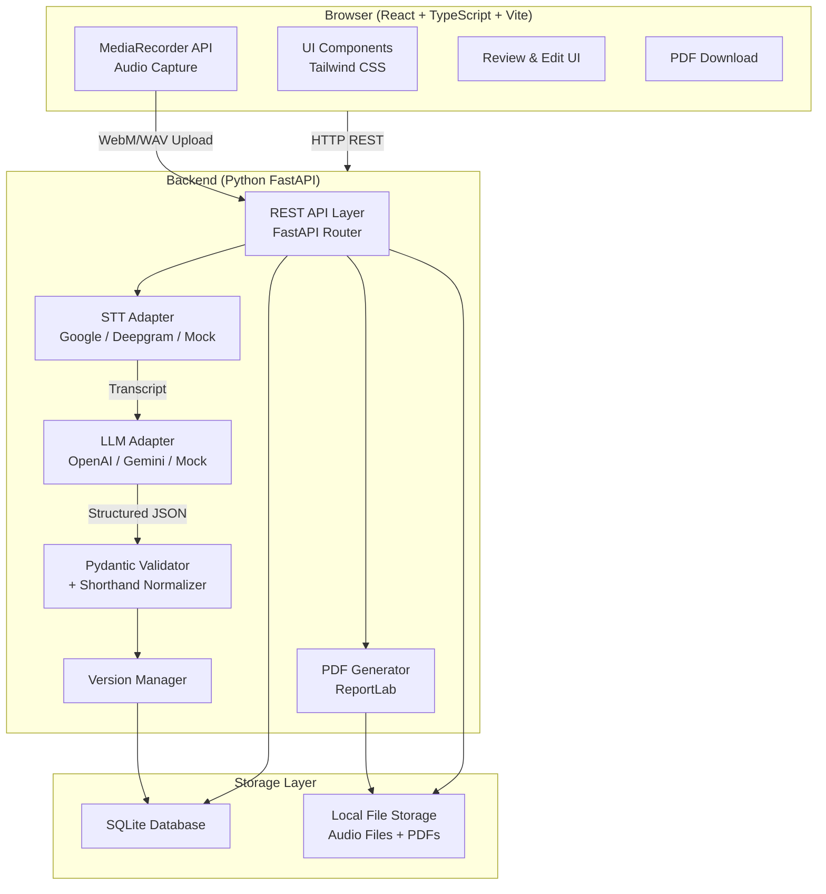
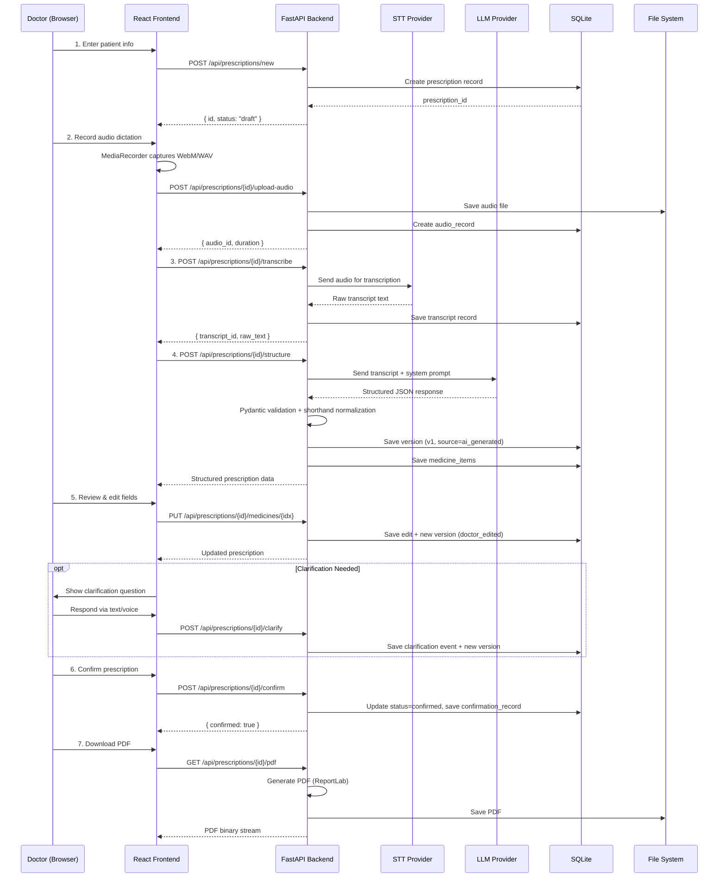
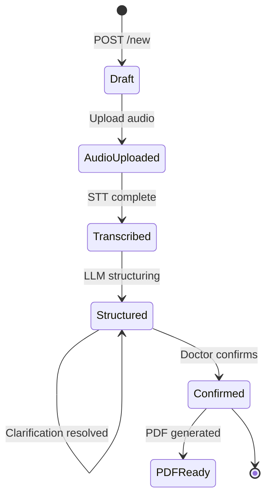
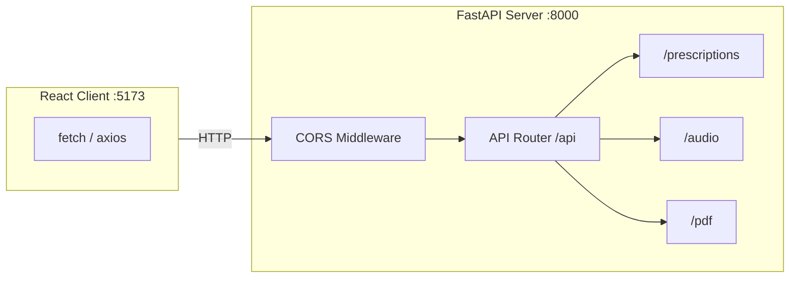

# System Architecture — Voice Prescription Writer

> **Version:** 1.0  
> **Last Updated:** 2026-11-03  
> **Status:** Approved for Development

---

## 1. System Overview

The Voice Prescription Writer is a web application that enables doctors to dictate prescriptions aloud, automatically transcribes the audio using configurable Speech-to-Text (STT) providers, structures the transcript into a validated prescription format using Large Language Models (LLMs), and produces a downloadable PDF after doctor review and confirmation.



---

## 2. Component Architecture

```mermaid
flowchart LR
    subgraph Frontend["Frontend — React + TypeScript + Vite"]
        direction TB
        Pages["Pages<br/>─────────<br/>NewPrescription<br/>PrescriptionReview<br/>PrescriptionList<br/>PrescriptionHistory"]
        Components["Components<br/>─────────<br/>AudioRecorder<br/>TranscriptView<br/>MedicineTable<br/>PatientInfoForm<br/>ClinicalFieldsForm<br/>VoiceEditBar<br/>ClarificationDialog<br/>ConfirmButton<br/>PDFDownloadButton"]
        Hooks["Custom Hooks<br/>─────────<br/>useAudioRecorder<br/>usePrescription<br/>useVoiceEdit<br/>useApiClient"]
        Services["API Services<br/>─────────<br/>prescriptionApi.ts<br/>audioApi.ts"]
        Types["TypeScript Types<br/>─────────<br/>Prescription<br/>Medicine<br/>Patient<br/>Transcript"]
    end

    subgraph Backend["Backend — Python FastAPI"]
        direction TB
        Routers["Routers<br/>─────────<br/>prescriptions.py<br/>audio.py<br/>pdf.py"]
        ServiceLayer["Services<br/>─────────<br/>prescription_service.py<br/>audio_service.py<br/>transcription_service.py<br/>structuring_service.py<br/>pdf_service.py<br/>version_service.py<br/>clarification_service.py<br/>voice_edit_service.py"]
        Adapters["Adapters<br/>─────────<br/>stt_base.py<br/>stt_google.py<br/>stt_deepgram.py<br/>stt_mock.py<br/>llm_base.py<br/>llm_openai.py<br/>llm_gemini.py<br/>llm_mock.py"]
        Models["Models<br/>─────────<br/>db_models.py<br/>schemas.py<br/>validators.py<br/>normalizers.py"]
        Config["Config<br/>─────────<br/>settings.py<br/>.env"]
    end

    subgraph Data["Data Layer"]
        direction TB
        DB["SQLite<br/>─────────<br/>prescriptions<br/>audio_records<br/>transcripts<br/>medicine_items<br/>prescription_versions<br/>doctor_edits<br/>clarification_events<br/>feedback_records<br/>confirmation_records"]
        Files["File System<br/>─────────<br/>uploads/audio/<br/>outputs/pdf/"]
    end

    Frontend -->|HTTP| Backend
    Backend --> Data
```



---

## 3. Technology Stack

| Layer | Technology | Version | Purpose |
|---|---|---|---|
| **Frontend Framework** | React | 18.x | UI component library |
| **Language** | TypeScript | 5.x | Type-safe frontend development |
| **Build Tool** | Vite | 5.x | Fast dev server and bundler |
| **Styling** | Tailwind CSS | 3.x | Utility-first CSS framework |
| **Backend Framework** | FastAPI | 0.110+ | Async Python REST API |
| **Validation** | Pydantic v2 | 2.x | Data validation and serialization |
| **Database** | SQLite | 3.x | Embedded relational database |
| **PDF Generation** | ReportLab | 4.x | Programmatic PDF creation |
| **STT (Option A)** | Google Cloud STT | v2 | Speech-to-Text transcription |
| **STT (Option B)** | Deepgram | Nova-2 | Speech-to-Text transcription |
| **LLM (Option A)** | OpenAI GPT | gpt-4o | Structured extraction |
| **LLM (Option B)** | Google Gemini | gemini-1.5-pro | Structured extraction |
| **HTTP Client** | httpx | 0.27+ | Async HTTP for provider calls |
| **Audio Capture** | MediaRecorder API | Web API | Browser-native audio recording |

---

## 4. Data Flow

The primary data flow follows a linear pipeline from audio capture through to PDF generation:



---

## 5. Module Boundaries

### 5.1 Frontend Modules

```
frontend/
├── public/
├── src/
│   ├── main.tsx                    # App entry point
│   ├── App.tsx                     # Root component with routing
│   ├── pages/
│   │   ├── NewPrescriptionPage.tsx # Patient info + recording
│   │   ├── ReviewPage.tsx          # Review structured output
│   │   ├── ListPage.tsx            # Prescription list
│   │   └── HistoryPage.tsx         # Version history view
│   ├── components/
│   │   ├── AudioRecorder.tsx       # Record/stop/playback controls
│   │   ├── TranscriptView.tsx      # Display raw transcript
│   │   ├── MedicineTable.tsx       # Editable medicine grid
│   │   ├── MedicineRow.tsx         # Individual medicine row
│   │   ├── PatientInfoForm.tsx     # Patient details form
│   │   ├── ClinicalFieldsForm.tsx  # Complaints, diagnosis, etc.
│   │   ├── VoiceEditBar.tsx        # Voice-based edit controls
│   │   ├── ClarificationDialog.tsx # Uncertainty resolution
│   │   ├── ConfirmButton.tsx       # Confirmation with safeguard
│   │   ├── PDFDownloadButton.tsx   # Download PDF
│   │   └── StatusBadge.tsx         # Draft/Confirmed badge
│   ├── hooks/
│   │   ├── useAudioRecorder.ts     # MediaRecorder encapsulation
│   │   ├── usePrescription.ts      # Prescription state management
│   │   ├── useVoiceEdit.ts         # Voice edit state
│   │   └── useApiClient.ts         # Fetch wrapper
│   ├── services/
│   │   ├── api.ts                  # Base API client (fetch + error handling)
│   │   ├── prescriptionApi.ts      # Prescription endpoints
│   │   └── audioApi.ts             # Audio upload endpoints
│   ├── types/
│   │   ├── prescription.ts         # Prescription, Medicine, Patient types
│   │   ├── transcript.ts           # Transcript types
│   │   └── api.ts                  # API response types
│   ├── utils/
│   │   ├── formatters.ts           # Display formatting
│   │   └── validators.ts           # Client-side validation
│   └── styles/
│       └── globals.css             # Tailwind directives
├── index.html
├── tailwind.config.js
├── tsconfig.json
├── vite.config.ts
└── package.json
```

### 5.2 Backend Modules

```
backend/
├── app/
│   ├── __init__.py
│   ├── main.py                     # FastAPI app factory
│   ├── config.py                   # Settings (pydantic-settings)
│   ├── database.py                 # SQLite connection + session
│   ├── routers/
│   │   ├── __init__.py
│   │   ├── prescriptions.py        # All prescription endpoints
│   │   ├── audio.py                # Audio upload/management
│   │   └── pdf.py                  # PDF generation endpoint
│   ├── services/
│   │   ├── __init__.py
│   │   ├── prescription_service.py # CRUD + business logic
│   │   ├── audio_service.py        # Audio file management
│   │   ├── transcription_service.py# Orchestrates STT call
│   │   ├── structuring_service.py  # Orchestrates LLM + validation
│   │   ├── pdf_service.py          # PDF generation logic
│   │   ├── version_service.py      # Version management
│   │   ├── clarification_service.py# Uncertainty + clarification
│   │   ├── voice_edit_service.py   # Parse & apply voice edits
│   │   └── feedback_service.py     # Feedback collection
│   ├── adapters/
│   │   ├── __init__.py
│   │   ├── stt/
│   │   │   ├── __init__.py
│   │   │   ├── base.py             # Abstract STT interface
│   │   │   ├── google_stt.py       # Google Cloud STT adapter
│   │   │   ├── deepgram_stt.py     # Deepgram adapter
│   │   │   └── mock_stt.py         # Mock for local dev
│   │   └── llm/
│   │       ├── __init__.py
│   │       ├── base.py             # Abstract LLM interface
│   │       ├── openai_llm.py       # OpenAI GPT adapter
│   │       ├── gemini_llm.py       # Google Gemini adapter
│   │       └── mock_llm.py         # Mock for local dev
│   ├── models/
│   │   ├── __init__.py
│   │   ├── db_models.py            # SQLAlchemy / raw SQL models
│   │   ├── schemas.py              # Pydantic request/response schemas
│   │   └── enums.py                # Status enums, frequency enums
│   ├── processing/
│   │   ├── __init__.py
│   │   ├── normalizers.py          # Shorthand normalization
│   │   ├── validators.py           # Source-grounded validation
│   │   └── prompts.py              # LLM prompt templates
│   └── utils/
│       ├── __init__.py
│       ├── file_utils.py           # File path management
│       └── hash_utils.py           # Prescription hashing
├── migrations/
│   └── 001_initial.sql             # Initial DB schema
├── tests/
│   ├── __init__.py
│   ├── conftest.py                 # Pytest fixtures
│   ├── test_api/                   # API endpoint tests
│   ├── test_services/              # Service layer tests
│   ├── test_adapters/              # Adapter unit tests
│   ├── test_processing/            # Normalizer + validator tests
│   └── test_data/                  # Test audio files + expected outputs
├── requirements.txt
├── .env.example
└── pyproject.toml
```

---

## 6. Key Design Patterns

### 6.1 Adapter Pattern (STT & LLM Providers)

All AI providers implement a common abstract interface, allowing runtime configuration via environment variables:

```python
# backend/app/adapters/stt/base.py
from abc import ABC, abstractmethod
from dataclasses import dataclass

@dataclass
class TranscriptionResult:
    raw_text: str
    provider: str
    provider_model: str
    latency_ms: int
    word_count: int

class STTAdapter(ABC):
    @abstractmethod
    async def transcribe(self, audio_path: str, language: str = "en-IN") -> TranscriptionResult:
        """Transcribe an audio file to text."""
        ...

# backend/app/adapters/llm/base.py
from abc import ABC, abstractmethod
from app.models.schemas import StructuredPrescription

class LLMAdapter(ABC):
    @abstractmethod
    async def structure_transcript(
        self, transcript: str, patient_context: dict
    ) -> StructuredPrescription:
        """Extract structured prescription data from transcript text."""
        ...
```

### 6.2 Provider Factory

```python
# backend/app/adapters/__init__.py
from app.config import settings

def get_stt_adapter() -> STTAdapter:
    match settings.STT_PROVIDER:
        case "google":
            from app.adapters.stt.google_stt import GoogleSTTAdapter
            return GoogleSTTAdapter()
        case "deepgram":
            from app.adapters.stt.deepgram_stt import DeepgramSTTAdapter
            return DeepgramSTTAdapter()
        case "mock":
            from app.adapters.stt.mock_stt import MockSTTAdapter
            return MockSTTAdapter()
        case _:
            raise ValueError(f"Unknown STT provider: {settings.STT_PROVIDER}")

def get_llm_adapter() -> LLMAdapter:
    match settings.LLM_PROVIDER:
        case "openai":
            from app.adapters.llm.openai_llm import OpenAILLMAdapter
            return OpenAILLMAdapter()
        case "gemini":
            from app.adapters.llm.gemini_llm import GeminiLLMAdapter
            return GeminiLLMAdapter()
        case "mock":
            from app.adapters.llm.mock_llm import MockLLMAdapter
            return MockLLMAdapter()
        case _:
            raise ValueError(f"Unknown LLM provider: {settings.LLM_PROVIDER}")
```

### 6.3 Version-Controlled Edits

Every edit operation creates a new `prescription_version` record, maintaining a full audit trail:



---

## 7. Configuration Management

```python
# backend/app/config.py
from pydantic_settings import BaseSettings

class Settings(BaseSettings):
    # Application
    APP_NAME: str = "Voice Prescription Writer"
    DEBUG: bool = False
    HOST: str = "0.0.0.0"
    PORT: int = 8000

    # Database
    DATABASE_URL: str = "sqlite:///./data/prescriptions.db"

    # File Storage
    AUDIO_UPLOAD_DIR: str = "./data/uploads/audio"
    PDF_OUTPUT_DIR: str = "./data/outputs/pdf"
    MAX_AUDIO_SIZE_MB: int = 50

    # STT Provider (google | deepgram | mock)
    STT_PROVIDER: str = "mock"
    GOOGLE_STT_CREDENTIALS_PATH: str = ""
    DEEPGRAM_API_KEY: str = ""

    # LLM Provider (openai | gemini | mock)
    LLM_PROVIDER: str = "mock"
    OPENAI_API_KEY: str = ""
    OPENAI_MODEL: str = "gpt-4o"
    GEMINI_API_KEY: str = ""
    GEMINI_MODEL: str = "gemini-1.5-pro"

    # LLM Settings
    LLM_TEMPERATURE: float = 0.0
    LLM_MAX_TOKENS: int = 4096

    # CORS
    CORS_ORIGINS: list[str] = ["http://localhost:5173"]

    class Config:
        env_file = ".env"
        env_file_encoding = "utf-8"

settings = Settings()
```

---

## 8. API Architecture



All endpoints are prefixed with `/api`. The frontend dev server (Vite on port 5173) proxies API requests to the backend (FastAPI on port 8000).

---

## 9. Error Handling Strategy

| Layer | Strategy |
|---|---|
| **Frontend** | Try/catch in API service layer → user-friendly toast notifications |
| **API Router** | FastAPI exception handlers → standardized JSON error responses |
| **Service Layer** | Custom exception classes (`TranscriptionError`, `StructuringError`, `ValidationError`) |
| **Adapters** | Provider-specific errors caught and wrapped into adapter exceptions |
| **Database** | SQLite errors wrapped with context; transactions for multi-table writes |

### Standard Error Response

```json
{
  "error": {
    "code": "TRANSCRIPTION_FAILED",
    "message": "STT provider returned an error",
    "details": "Google Cloud STT: Audio format not supported"
  }
}
```

---

## 10. Security Considerations

> [!IMPORTANT]
> This is a prototype/assignment application. It is **not** designed for production use with real patient data.

| Concern | Mitigation |
|---|---|
| **No Real Patient Data** | All test data uses fictional patients. No PHI/PII compliance required for prototype. |
| **API Keys** | Stored in `.env` file, loaded via `pydantic-settings`. `.env` is in `.gitignore`. |
| **CORS** | Restricted to `localhost:5173` in development. |
| **File Uploads** | Size limits enforced (50MB max). File type validation (WebM, WAV only). |
| **SQL Injection** | Parameterized queries only. No raw string interpolation in SQL. |
| **Input Validation** | Pydantic v2 validates all request bodies. |
| **Confirmation Integrity** | Prescription hash stored at confirmation time to detect post-confirmation tampering. |
| **No Authentication** | Single-user prototype. No login required. `confirmed_by` is a self-reported string. |
| **Audio Files** | Stored on local filesystem, not accessible via direct URL. Served through API only. |

---

## 11. Deployment Architecture (Development)

```
┌─────────────────────────────────┐
│         Developer Machine       │
│                                 │
│  ┌───────────┐  ┌────────────┐  │
│  │  Vite     │  │  FastAPI   │  │
│  │  Dev      │  │  (uvicorn) │  │
│  │  Server   │  │            │  │
│  │  :5173    │──│  :8000     │  │
│  └───────────┘  └─────┬──────┘  │
│                       │         │
│              ┌────────┴───────┐ │
│              │  SQLite DB     │ │
│              │  data/*.db     │ │
│              └────────────────┘ │
│              ┌────────────────┐ │
│              │  File Storage  │ │
│              │  data/uploads/ │ │
│              │  data/outputs/ │ │
│              └────────────────┘ │
└─────────────────────────────────┘
         │              │
         ▼              ▼
   ┌───────────┐  ┌───────────┐
   │ STT API   │  │ LLM API   │
   │ (Google/  │  │ (OpenAI/  │
   │  Deepgram)│  │  Gemini)  │
   └───────────┘  └───────────┘
```

---

## 12. Cross-Cutting Concerns

### 12.1 Logging

- Python `logging` module with structured JSON output.
- Log levels: DEBUG for development, INFO for production.
- All STT/LLM calls logged with latency, provider, and token counts.

### 12.2 Request Tracing

- Each prescription gets a unique UUID as its primary identifier.
- All related records (audio, transcript, versions, edits) reference back to `prescription_id`.

### 12.3 Performance Targets

| Operation | Target Latency |
|---|---|
| Audio upload (30s clip) | < 2s |
| STT transcription | < 10s |
| LLM structuring | < 15s |
| PDF generation | < 3s |
| Database queries | < 100ms |

### 12.4 Browser Compatibility

- Target: Chrome 90+, Edge 90+, Firefox 90+, Safari 15+.
- MediaRecorder API supported in all target browsers.
- Audio format: WebM (Opus) primary, WAV fallback.
