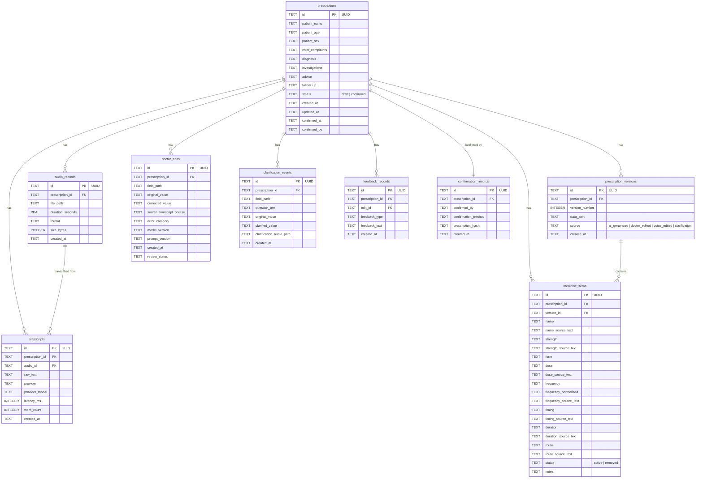

# Database Schema — Voice Prescription Writer

> **Version:** 1.0  
> **Database Engine:** SQLite 3  
> **Last Updated:** 2026-11-03

---

## Entity-Relationship Diagram



---

## CREATE TABLE Statements

### prescriptions

The core table representing a single prescription session.

```sql
CREATE TABLE IF NOT EXISTS prescriptions (
    id                TEXT PRIMARY KEY,                          -- UUID v4
    patient_name      TEXT NOT NULL,                             -- Full patient name
    patient_age       TEXT NOT NULL,                             -- e.g. "45 years", "6 months"
    patient_sex       TEXT NOT NULL CHECK (patient_sex IN ('Male', 'Female', 'Other')),
    chief_complaints  TEXT,                                      -- Free text
    diagnosis         TEXT,                                      -- Free text
    investigations    TEXT,                                      -- Free text
    advice            TEXT,                                      -- Free text
    follow_up         TEXT,                                      -- e.g. "After 5 days"
    status            TEXT NOT NULL DEFAULT 'draft'
                      CHECK (status IN ('draft', 'confirmed')),
    created_at        TEXT NOT NULL DEFAULT (strftime('%Y-%m-%dT%H:%M:%SZ', 'now')),
    updated_at        TEXT NOT NULL DEFAULT (strftime('%Y-%m-%dT%H:%M:%SZ', 'now')),
    confirmed_at      TEXT,                                      -- ISO 8601 timestamp
    confirmed_by      TEXT                                       -- Doctor name / identifier
);
```

### audio_records

Stores metadata for uploaded audio files. The actual audio is on the filesystem.

```sql
CREATE TABLE IF NOT EXISTS audio_records (
    id                TEXT PRIMARY KEY,                          -- UUID v4
    prescription_id   TEXT NOT NULL,
    file_path         TEXT NOT NULL,                             -- Relative path to audio file
    duration_seconds  REAL,                                      -- Duration in seconds
    format            TEXT NOT NULL CHECK (format IN ('webm', 'wav', 'mp3', 'ogg')),
    size_bytes        INTEGER NOT NULL,
    created_at        TEXT NOT NULL DEFAULT (strftime('%Y-%m-%dT%H:%M:%SZ', 'now')),

    FOREIGN KEY (prescription_id) REFERENCES prescriptions(id)
        ON DELETE CASCADE
);
```

### transcripts

Stores raw transcription output from STT providers.

```sql
CREATE TABLE IF NOT EXISTS transcripts (
    id                TEXT PRIMARY KEY,                          -- UUID v4
    prescription_id   TEXT NOT NULL,
    audio_id          TEXT NOT NULL,                             -- References audio_records.id
    raw_text          TEXT NOT NULL,                             -- Full transcript text
    provider          TEXT NOT NULL,                             -- e.g. "google", "deepgram", "mock"
    provider_model    TEXT,                                      -- e.g. "chirp_2", "nova-2"
    latency_ms        INTEGER,                                   -- Transcription latency
    word_count        INTEGER,                                   -- Word count of transcript
    created_at        TEXT NOT NULL DEFAULT (strftime('%Y-%m-%dT%H:%M:%SZ', 'now')),

    FOREIGN KEY (prescription_id) REFERENCES prescriptions(id)
        ON DELETE CASCADE,
    FOREIGN KEY (audio_id) REFERENCES audio_records(id)
        ON DELETE CASCADE
);
```

### prescription_versions

Full snapshot of prescription data at each version. Enables complete audit trail and undo.

```sql
CREATE TABLE IF NOT EXISTS prescription_versions (
    id                TEXT PRIMARY KEY,                          -- UUID v4
    prescription_id   TEXT NOT NULL,
    version_number    INTEGER NOT NULL,                          -- Sequential: 1, 2, 3...
    data_json         TEXT NOT NULL,                             -- Complete prescription snapshot as JSON
    source            TEXT NOT NULL
                      CHECK (source IN ('ai_generated', 'doctor_edited', 'voice_edited', 'clarification')),
    created_at        TEXT NOT NULL DEFAULT (strftime('%Y-%m-%dT%H:%M:%SZ', 'now')),

    FOREIGN KEY (prescription_id) REFERENCES prescriptions(id)
        ON DELETE CASCADE,
    UNIQUE (prescription_id, version_number)
);
```

### medicine_items

Individual medicine entries belonging to a prescription version. Denormalized for query performance.

```sql
CREATE TABLE IF NOT EXISTS medicine_items (
    id                    TEXT PRIMARY KEY,                      -- UUID v4
    prescription_id       TEXT NOT NULL,
    version_id            TEXT NOT NULL,                          -- References prescription_versions.id
    name                  TEXT NOT NULL,                          -- Drug name, e.g. "Dolo 650"
    name_source_text      TEXT,                                   -- Exact phrase from transcript
    strength              TEXT,                                   -- e.g. "650mg", "500mg"
    strength_source_text  TEXT,
    form                  TEXT,                                   -- e.g. "Tablet", "Syrup", "Injection"
    dose                  TEXT,                                   -- e.g. "1 tablet", "2 teaspoons"
    dose_source_text      TEXT,
    frequency             TEXT,                                   -- e.g. "Three times a day"
    frequency_normalized  TEXT,                                   -- e.g. "TDS", "BD", "OD"
    frequency_source_text TEXT,
    timing                TEXT,                                   -- e.g. "before breakfast", "at bedtime"
    timing_source_text    TEXT,
    duration              TEXT,                                   -- e.g. "5 days", "1 week"
    duration_source_text  TEXT,
    route                 TEXT,                                   -- e.g. "Oral", "IV", "Topical"
    route_source_text     TEXT,
    status                TEXT NOT NULL DEFAULT 'active'
                          CHECK (status IN ('active', 'removed')),
    notes                 TEXT,

    FOREIGN KEY (prescription_id) REFERENCES prescriptions(id)
        ON DELETE CASCADE,
    FOREIGN KEY (version_id) REFERENCES prescription_versions(id)
        ON DELETE CASCADE
);
```

### doctor_edits

Records every manual correction made by the doctor. Used for AI feedback loop analysis.

```sql
CREATE TABLE IF NOT EXISTS doctor_edits (
    id                       TEXT PRIMARY KEY,                   -- UUID v4
    prescription_id          TEXT NOT NULL,
    field_path               TEXT NOT NULL,                       -- e.g. "medicines[0].strength"
    original_value           TEXT,                                -- Value before edit
    corrected_value          TEXT,                                -- Value after edit
    source_transcript_phrase TEXT,                                -- Relevant transcript excerpt
    error_category           TEXT,                                -- e.g. "strength_correction", "name_correction"
    model_version            TEXT,                                -- LLM model used for initial extraction
    prompt_version           TEXT,                                -- Prompt version used
    created_at               TEXT NOT NULL DEFAULT (strftime('%Y-%m-%dT%H:%M:%SZ', 'now')),
    review_status            TEXT DEFAULT 'pending'
                             CHECK (review_status IN ('pending', 'reviewed', 'incorporated')),

    FOREIGN KEY (prescription_id) REFERENCES prescriptions(id)
        ON DELETE CASCADE
);
```

### clarification_events

Records uncertainty resolution interactions.

```sql
CREATE TABLE IF NOT EXISTS clarification_events (
    id                       TEXT PRIMARY KEY,                   -- UUID v4
    prescription_id          TEXT NOT NULL,
    field_path               TEXT NOT NULL,                       -- e.g. "medicines[0].strength"
    question_text            TEXT NOT NULL,                       -- Question shown to doctor
    original_value           TEXT,                                -- Original "unclear" value
    clarified_value          TEXT NOT NULL,                       -- Resolved value
    clarification_audio_path TEXT,                                -- Path to audio if voice clarification
    created_at               TEXT NOT NULL DEFAULT (strftime('%Y-%m-%dT%H:%M:%SZ', 'now')),

    FOREIGN KEY (prescription_id) REFERENCES prescriptions(id)
        ON DELETE CASCADE
);
```

### feedback_records

Doctor feedback about AI output quality.

```sql
CREATE TABLE IF NOT EXISTS feedback_records (
    id                TEXT PRIMARY KEY,                          -- UUID v4
    prescription_id   TEXT NOT NULL,
    edit_id           TEXT,                                       -- Optional link to doctor_edits
    feedback_type     TEXT NOT NULL
                      CHECK (feedback_type IN ('ai_error', 'stt_error', 'ui_issue', 'general')),
    feedback_text     TEXT NOT NULL,
    created_at        TEXT NOT NULL DEFAULT (strftime('%Y-%m-%dT%H:%M:%SZ', 'now')),

    FOREIGN KEY (prescription_id) REFERENCES prescriptions(id)
        ON DELETE CASCADE,
    FOREIGN KEY (edit_id) REFERENCES doctor_edits(id)
        ON DELETE SET NULL
);
```

### confirmation_records

Immutable record of prescription confirmation events.

```sql
CREATE TABLE IF NOT EXISTS confirmation_records (
    id                  TEXT PRIMARY KEY,                        -- UUID v4
    prescription_id     TEXT NOT NULL UNIQUE,                    -- One confirmation per prescription
    confirmed_by        TEXT NOT NULL,                           -- Doctor name
    confirmation_method TEXT NOT NULL DEFAULT 'manual_review',
    prescription_hash   TEXT NOT NULL,                           -- SHA-256 hash of prescription data at confirmation
    created_at          TEXT NOT NULL DEFAULT (strftime('%Y-%m-%dT%H:%M:%SZ', 'now')),

    FOREIGN KEY (prescription_id) REFERENCES prescriptions(id)
        ON DELETE CASCADE
);
```

---

## Indexes

```sql
-- Performance indexes for common queries
CREATE INDEX IF NOT EXISTS idx_prescriptions_status
    ON prescriptions(status);

CREATE INDEX IF NOT EXISTS idx_prescriptions_created_at
    ON prescriptions(created_at DESC);

CREATE INDEX IF NOT EXISTS idx_prescriptions_patient_name
    ON prescriptions(patient_name);

CREATE INDEX IF NOT EXISTS idx_audio_records_prescription_id
    ON audio_records(prescription_id);

CREATE INDEX IF NOT EXISTS idx_transcripts_prescription_id
    ON transcripts(prescription_id);

CREATE INDEX IF NOT EXISTS idx_transcripts_audio_id
    ON transcripts(audio_id);

CREATE INDEX IF NOT EXISTS idx_prescription_versions_prescription_id
    ON prescription_versions(prescription_id);

CREATE INDEX IF NOT EXISTS idx_prescription_versions_version_number
    ON prescription_versions(prescription_id, version_number);

CREATE INDEX IF NOT EXISTS idx_medicine_items_prescription_id
    ON medicine_items(prescription_id);

CREATE INDEX IF NOT EXISTS idx_medicine_items_version_id
    ON medicine_items(version_id);

CREATE INDEX IF NOT EXISTS idx_medicine_items_status
    ON medicine_items(status);

CREATE INDEX IF NOT EXISTS idx_doctor_edits_prescription_id
    ON doctor_edits(prescription_id);

CREATE INDEX IF NOT EXISTS idx_doctor_edits_error_category
    ON doctor_edits(error_category);

CREATE INDEX IF NOT EXISTS idx_doctor_edits_review_status
    ON doctor_edits(review_status);

CREATE INDEX IF NOT EXISTS idx_clarification_events_prescription_id
    ON clarification_events(prescription_id);

CREATE INDEX IF NOT EXISTS idx_feedback_records_prescription_id
    ON feedback_records(prescription_id);

CREATE INDEX IF NOT EXISTS idx_feedback_records_edit_id
    ON feedback_records(edit_id);

CREATE INDEX IF NOT EXISTS idx_confirmation_records_prescription_id
    ON confirmation_records(prescription_id);
```

---

## Full Migration Script

The complete initial migration script combining all tables and indexes:

```sql
-- Migration: 001_initial.sql
-- Voice Prescription Writer - Initial Schema
-- SQLite 3
-- Created: 2026-11-03

PRAGMA journal_mode=WAL;
PRAGMA foreign_keys=ON;

-- ============================================================
-- TABLES
-- ============================================================

CREATE TABLE IF NOT EXISTS prescriptions (
    id                TEXT PRIMARY KEY,
    patient_name      TEXT NOT NULL,
    patient_age       TEXT NOT NULL,
    patient_sex       TEXT NOT NULL CHECK (patient_sex IN ('Male', 'Female', 'Other')),
    chief_complaints  TEXT,
    diagnosis         TEXT,
    investigations    TEXT,
    advice            TEXT,
    follow_up         TEXT,
    status            TEXT NOT NULL DEFAULT 'draft'
                      CHECK (status IN ('draft', 'confirmed')),
    created_at        TEXT NOT NULL DEFAULT (strftime('%Y-%m-%dT%H:%M:%SZ', 'now')),
    updated_at        TEXT NOT NULL DEFAULT (strftime('%Y-%m-%dT%H:%M:%SZ', 'now')),
    confirmed_at      TEXT,
    confirmed_by      TEXT
);

CREATE TABLE IF NOT EXISTS audio_records (
    id                TEXT PRIMARY KEY,
    prescription_id   TEXT NOT NULL,
    file_path         TEXT NOT NULL,
    duration_seconds  REAL,
    format            TEXT NOT NULL CHECK (format IN ('webm', 'wav', 'mp3', 'ogg')),
    size_bytes        INTEGER NOT NULL,
    created_at        TEXT NOT NULL DEFAULT (strftime('%Y-%m-%dT%H:%M:%SZ', 'now')),
    FOREIGN KEY (prescription_id) REFERENCES prescriptions(id) ON DELETE CASCADE
);

CREATE TABLE IF NOT EXISTS transcripts (
    id                TEXT PRIMARY KEY,
    prescription_id   TEXT NOT NULL,
    audio_id          TEXT NOT NULL,
    raw_text          TEXT NOT NULL,
    provider          TEXT NOT NULL,
    provider_model    TEXT,
    latency_ms        INTEGER,
    word_count        INTEGER,
    created_at        TEXT NOT NULL DEFAULT (strftime('%Y-%m-%dT%H:%M:%SZ', 'now')),
    FOREIGN KEY (prescription_id) REFERENCES prescriptions(id) ON DELETE CASCADE,
    FOREIGN KEY (audio_id) REFERENCES audio_records(id) ON DELETE CASCADE
);

CREATE TABLE IF NOT EXISTS prescription_versions (
    id                TEXT PRIMARY KEY,
    prescription_id   TEXT NOT NULL,
    version_number    INTEGER NOT NULL,
    data_json         TEXT NOT NULL,
    source            TEXT NOT NULL
                      CHECK (source IN ('ai_generated', 'doctor_edited', 'voice_edited', 'clarification')),
    created_at        TEXT NOT NULL DEFAULT (strftime('%Y-%m-%dT%H:%M:%SZ', 'now')),
    FOREIGN KEY (prescription_id) REFERENCES prescriptions(id) ON DELETE CASCADE,
    UNIQUE (prescription_id, version_number)
);

CREATE TABLE IF NOT EXISTS medicine_items (
    id                    TEXT PRIMARY KEY,
    prescription_id       TEXT NOT NULL,
    version_id            TEXT NOT NULL,
    name                  TEXT NOT NULL,
    name_source_text      TEXT,
    strength              TEXT,
    strength_source_text  TEXT,
    form                  TEXT,
    dose                  TEXT,
    dose_source_text      TEXT,
    frequency             TEXT,
    frequency_normalized  TEXT,
    frequency_source_text TEXT,
    timing                TEXT,
    timing_source_text    TEXT,
    duration              TEXT,
    duration_source_text  TEXT,
    route                 TEXT,
    route_source_text     TEXT,
    status                TEXT NOT NULL DEFAULT 'active'
                          CHECK (status IN ('active', 'removed')),
    notes                 TEXT,
    FOREIGN KEY (prescription_id) REFERENCES prescriptions(id) ON DELETE CASCADE,
    FOREIGN KEY (version_id) REFERENCES prescription_versions(id) ON DELETE CASCADE
);

CREATE TABLE IF NOT EXISTS doctor_edits (
    id                       TEXT PRIMARY KEY,
    prescription_id          TEXT NOT NULL,
    field_path               TEXT NOT NULL,
    original_value           TEXT,
    corrected_value          TEXT,
    source_transcript_phrase TEXT,
    error_category           TEXT,
    model_version            TEXT,
    prompt_version           TEXT,
    created_at               TEXT NOT NULL DEFAULT (strftime('%Y-%m-%dT%H:%M:%SZ', 'now')),
    review_status            TEXT DEFAULT 'pending'
                             CHECK (review_status IN ('pending', 'reviewed', 'incorporated')),
    FOREIGN KEY (prescription_id) REFERENCES prescriptions(id) ON DELETE CASCADE
);

CREATE TABLE IF NOT EXISTS clarification_events (
    id                       TEXT PRIMARY KEY,
    prescription_id          TEXT NOT NULL,
    field_path               TEXT NOT NULL,
    question_text            TEXT NOT NULL,
    original_value           TEXT,
    clarified_value          TEXT NOT NULL,
    clarification_audio_path TEXT,
    created_at               TEXT NOT NULL DEFAULT (strftime('%Y-%m-%dT%H:%M:%SZ', 'now')),
    FOREIGN KEY (prescription_id) REFERENCES prescriptions(id) ON DELETE CASCADE
);

CREATE TABLE IF NOT EXISTS feedback_records (
    id                TEXT PRIMARY KEY,
    prescription_id   TEXT NOT NULL,
    edit_id           TEXT,
    feedback_type     TEXT NOT NULL
                      CHECK (feedback_type IN ('ai_error', 'stt_error', 'ui_issue', 'general')),
    feedback_text     TEXT NOT NULL,
    created_at        TEXT NOT NULL DEFAULT (strftime('%Y-%m-%dT%H:%M:%SZ', 'now')),
    FOREIGN KEY (prescription_id) REFERENCES prescriptions(id) ON DELETE CASCADE,
    FOREIGN KEY (edit_id) REFERENCES doctor_edits(id) ON DELETE SET NULL
);

CREATE TABLE IF NOT EXISTS confirmation_records (
    id                  TEXT PRIMARY KEY,
    prescription_id     TEXT NOT NULL UNIQUE,
    confirmed_by        TEXT NOT NULL,
    confirmation_method TEXT NOT NULL DEFAULT 'manual_review',
    prescription_hash   TEXT NOT NULL,
    created_at          TEXT NOT NULL DEFAULT (strftime('%Y-%m-%dT%H:%M:%SZ', 'now')),
    FOREIGN KEY (prescription_id) REFERENCES prescriptions(id) ON DELETE CASCADE
);

-- ============================================================
-- INDEXES
-- ============================================================

CREATE INDEX IF NOT EXISTS idx_prescriptions_status ON prescriptions(status);
CREATE INDEX IF NOT EXISTS idx_prescriptions_created_at ON prescriptions(created_at DESC);
CREATE INDEX IF NOT EXISTS idx_prescriptions_patient_name ON prescriptions(patient_name);
CREATE INDEX IF NOT EXISTS idx_audio_records_prescription_id ON audio_records(prescription_id);
CREATE INDEX IF NOT EXISTS idx_transcripts_prescription_id ON transcripts(prescription_id);
CREATE INDEX IF NOT EXISTS idx_transcripts_audio_id ON transcripts(audio_id);
CREATE INDEX IF NOT EXISTS idx_prescription_versions_prescription_id ON prescription_versions(prescription_id);
CREATE INDEX IF NOT EXISTS idx_prescription_versions_version_number ON prescription_versions(prescription_id, version_number);
CREATE INDEX IF NOT EXISTS idx_medicine_items_prescription_id ON medicine_items(prescription_id);
CREATE INDEX IF NOT EXISTS idx_medicine_items_version_id ON medicine_items(version_id);
CREATE INDEX IF NOT EXISTS idx_medicine_items_status ON medicine_items(status);
CREATE INDEX IF NOT EXISTS idx_doctor_edits_prescription_id ON doctor_edits(prescription_id);
CREATE INDEX IF NOT EXISTS idx_doctor_edits_error_category ON doctor_edits(error_category);
CREATE INDEX IF NOT EXISTS idx_doctor_edits_review_status ON doctor_edits(review_status);
CREATE INDEX IF NOT EXISTS idx_clarification_events_prescription_id ON clarification_events(prescription_id);
CREATE INDEX IF NOT EXISTS idx_feedback_records_prescription_id ON feedback_records(prescription_id);
CREATE INDEX IF NOT EXISTS idx_feedback_records_edit_id ON feedback_records(edit_id);
CREATE INDEX IF NOT EXISTS idx_confirmation_records_prescription_id ON confirmation_records(prescription_id);
```

---

## Design Notes

### Why SQLite?

> [!NOTE]
> SQLite was chosen for this prototype for the following reasons:
> - **Zero configuration** — no database server to install or manage
> - **Single-file database** — easy to share, backup, and version
> - **Sufficient for single-user prototype** — no concurrent write contention
> - **WAL mode enabled** — allows concurrent reads during writes
> - **Foreign key support** — enabled via PRAGMA for referential integrity

### UUID Primary Keys

All tables use UUID v4 strings as primary keys instead of auto-incrementing integers. This ensures:
- Globally unique identifiers across all tables
- Safe for distributed systems if ever needed
- No sequential enumeration of records

### Timestamps

All timestamps are stored as ISO 8601 strings in UTC (e.g., `2026-11-03T14:30:00Z`). SQLite does not have a native datetime type, so TEXT with consistent formatting is used.

### JSON Storage

The `prescription_versions.data_json` column stores a complete JSON snapshot of the prescription state at each version. This enables:
- Full audit trail with point-in-time reconstruction
- Comparison between versions
- Undo capability without complex reverse-operation logic

### Soft Deletion

Medicines are soft-deleted using `status = 'removed'` rather than physical deletion. This preserves audit trail and supports voice commands like "remove the Amitriptyline".

### Migration Strategy

For this prototype, we use a simple file-based migration approach:
1. Migration files are numbered sequentially: `001_initial.sql`, `002_add_column.sql`
2. A `schema_version` table tracks applied migrations
3. On app startup, unapplied migrations are run in order

```sql
CREATE TABLE IF NOT EXISTS schema_version (
    version   INTEGER PRIMARY KEY,
    filename  TEXT NOT NULL,
    applied_at TEXT NOT NULL DEFAULT (strftime('%Y-%m-%dT%H:%M:%SZ', 'now'))
);
```
