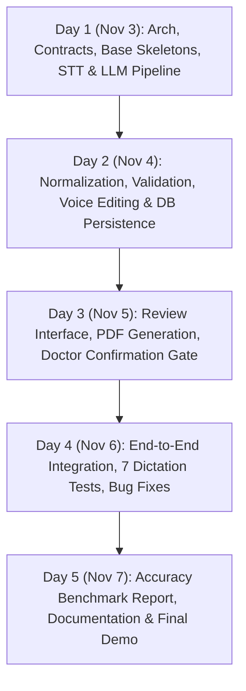

# Team Plan: Voice Prescription Writer

## 1. Team Allocation (3 Full-Stack Engineers)

| Engineer | Focus Areas | Primary Modules |
|----------|-------------|-----------------|
| **Engineer 1 (Lead / Full-Stack & Frontend)** | Frontend, Audio Capture, Review UI, Evidence Highlighting | Module 1 (UI/Audio), Module 6 (Clarification UI), Integration |
| **Engineer 2 (Backend & AI Engineer)** | STT Adapters, LLM Structuring, Shorthand Normalizer, Grounding Engine | Module 2 (STT), Module 3 (LLM), Module 4 (Normalization), Module 5 (Validation) |
| **Engineer 3 (Backend, Systems & QA)** | Database, Audit Trail, Voice Editing, PDF Generation, Test Suite | Module 7 (Voice Edit), Module 8 (DB/Audit), Module 9 (Feedback), Module 10 (PDF) |

---

## 2. Milestone Schedule (Deadline: 7 November 2026)

---

## 3. Communication & Code Hygiene

- **Branching Policy**:
  - `main`: Always deployable and passing tests
  - Feature branches: `feature/frontend-audio`, `feature/ai-structuring`, `feature/voice-edit-pdf`
- **Zero Secrets Policy**: Never commit `.env` or keys. Mock implementations must enable local development and testing without paid API accounts.
- **Mock First**: Skeletons and contracts allow Frontend and Backend to progress concurrently without blocking.

